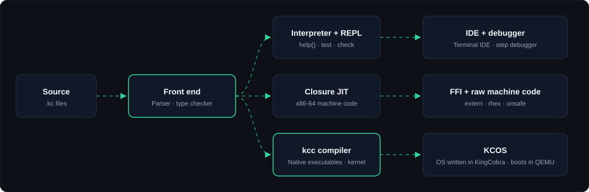

<div align="center">



<br>

[](https://github.com/DivyanshuSinha136)
[](https://pypi.org/user/DivyanshuSinha/)
[](https://github.com/DivyanshuSinha136/KingCobra)
[](https://www.python.org/psf/)
[](mailto:divyanshu.sinha631@gmail.com)

**[About](#about)** &nbsp;·&nbsp; **[KingCobra](#kingcobra)** &nbsp;·&nbsp; **[Projects](#projects)** &nbsp;·&nbsp; **[Tech stack](#tech-stack)** &nbsp;·&nbsp; **[GitHub analytics](#github-analytics)** &nbsp;·&nbsp; **[Contact](#contact)**

</div>


<h2 id="about"> About</h2>

I build software from first principles: **AI systems, programming languages, assemblers and operating systems**. I started with Python and moved down the stack to C, C++, Assembly and bare-metal x86 machine code. I also ship secure web applications and security tooling.

|  |  |
|:--|:--|
| **Name** | Divyanshu Sinha |
| **Age** | 18 |
| **Region** | India |
| **Email** | [divyanshu.sinha631@gmail.com](mailto:divyanshu.sinha631@gmail.com) |
| **Focus** | Programming languages, operating systems, AI backends, security software |
| **Creator of** | `pythonaibrain` · `pythonaibrain-client` · `TigerASM` · `KingCobra` · `CDNEE` · `Aetherix` · `Peacock OS` |

**Highlights**

- Earned the [Quickdraw achievement](https://github.com/users/DivyanshuSinha136/achievements/quickdraw) on GitHub.
- Built AI systems from scratch: rule-based engines, Python AI backends and an Assembly-based AI.
- Published Python packages on PyPI: [`pythonaibrain`](https://pypi.org/project/pythonaibrain/) and [`pythonaibrain-client`](https://pypi.org/project/pythonaibrain-client/).
- Designed three languages and tools in the same space: KingCobra, CDNEE and the TigerASM assembler.
- Developed games and simulation engines (3D assets, train simulations) and an interactive Class 12 Physics GUI.
- Skilled in ethical hacking, security software and encryption systems.
- Built secure web applications with OTP verification, encryption and real-time features.


<h2 id="kingcobra"> KingCobra</h2>

<a href="https://github.com/DivyanshuSinha136/KingCobra"></a>

<div align="center">

[](https://github.com/DivyanshuSinha136/KingCobra)
[](https://github.com/DivyanshuSinha136/KingCobra/releases)
[](https://github.com/DivyanshuSinha136/KingCobra/blob/HEAD/LICENSE)

</div>

> [!NOTE]
> **KingCobra is my flagship project.** It is an independent, actively developed programming language with its own syntax, runtime, JIT, compiler and standard library. Source files use the **`.kc`** extension. It is a native systems language with scripting-language ergonomics, not a Python dialect, and it has no relation to other languages named "Cobra".

**What it is.** KingCobra has a small, readable syntax and a REPL, but it also gives you explicit memory, checked C-style pointers, a real FFI, raw machine code and a bare-metal compiler target. The language, runtime, JIT and every standard-library module are plain **C11** with **no third-party build-time dependencies**.

```kingcobra
struct Point { x: int, y: int }
impl Point { fn len2(self) -> int { return self.x * self.x + self.y * self.y; } }

fn main() {
    let nums = [5, 3, 8, 1, 9];
    let [first, ...rest] = nums;
    print(f"first={first}", Point { x: 3, y: 4 }.len2(), nums[1..3]);

    try { throw error("rejected"); } catch (e) { print(e.message); }
}
```

<h3> Key capabilities</h3>

| Area | What you get |
|:--|:--|
| **Easy like a script** | `let`/`var`, f-strings, slicing, destructuring, `match`, `try`/`catch`, a REPL and `help()` with `///` doc comments |
| **Native underneath** | Exact 64-bit integers, a closure JIT to x86-64 machine code, a real `extern` FFI, `rhex` and `unsafe` for raw machine code |
| **Explicit memory, no GC** | `free` on every heap value, use-after-free and double free are errors, `defer` runs during unwinding, `--leaks` finds what you forgot |
| **Checked pointers** | C-style pointers and buffers with bounds and lifetime checking |
| **Real tooling** | Built-in `test` and `check`, a static type checker, errors with source excerpts and "did you mean", a terminal IDE and a debugger |
| **Bare metal** | `kcc` compiles to standalone executables and to a freestanding kernel; **KCOS**, an OS written in KingCobra, boots in QEMU |
| **Portable** | Linux and Windows (macOS builds with `make`) on x86-64, ARM64, ARMhf and RISC-V |

<h3> Toolchain architecture</h3>

<div align="center">

</div>

<h3> Standard library: 21 native modules</h3>

| Category | Modules |
|:--|:--|
| **Systems and hardware** | `std.acpi` · `std.mmio` · `std.mmu` · `std.memory` · `std.rhex` · `std.system` |
| **I/O and data** | `std.io` · `std.fbin` · `std.csv` · `std.json` · `std.regx` |
| **Networking** | `std.network` · `std.http` (HTTP and TLS) |
| **Compute and AI** | `std.vector` · `std.nn` · `std.nlp` |
| **Media and interfaces** | `std.gui` · `std.game` · `std.ascii_screen` · `std.music_note` · `std.tts` |

<h3> Quick start</h3>

Requires a C11 compiler and `make`.

```bash
git clone https://github.com/DivyanshuSinha136/KingCobra.git
cd KingCobra

make                               # builds ./kingcobra
./kingcobra run examples/hello.kc  # run a program
./kingcobra repl                   # interactive REPL
make test                          # run every example end to end
```

[Documentation](https://github.com/DivyanshuSinha136/KingCobra/tree/HEAD/docs) &nbsp;·&nbsp; [Releases](https://github.com/DivyanshuSinha136/KingCobra/releases) &nbsp;·&nbsp; [Issues](https://github.com/DivyanshuSinha136/KingCobra/issues) &nbsp;·&nbsp; [Contributing](https://github.com/DivyanshuSinha136/KingCobra/blob/HEAD/CONTRIBUTING.md)


<h2 id="projects"> Key projects</h2>

| Project | Category |
|:--|:--|
| [KingCobra](#kingcobra-project) | Programming language |
| [CDNEE](#cdnee) | Programming language |
| [TigerASM](#tigerasm) | Assembler |
| [Peacock OS](#peacock-os) | Operating system |
| [pythonaibrain](#pythonaibrain) | AI backend |
| [pythonaibrain-client](#pythonaibrain-client) | Client library |
| [Aetherix](#aetherix) | Open-source project |

<h3 id="pythonaibrain"><a href="https://pypi.org/project/pythonaibrain/">pythonaibrain</a></h3>

An AI backend with advanced contextual understanding, self-learning capabilities, and integration-ready APIs.

<h3 id="pythonaibrain-client"><a href="https://pypi.org/project/pythonaibrain-client/">pythonaibrain-client</a></h3>

Client library to easily interact with `pythonaibrain` servers and APIs.

<h3 id="tigerasm"><a href="https://github.com/DivyanshuSinha136/TigerASM">TigerASM</a></h3>

Custom assembler for learning low-level programming, system design, and assembly code execution.

<h3 id="kingcobra-project"><a href="https://github.com/DivyanshuSinha136/KingCobra">KingCobra Programming Language</a></h3>

Native, general-purpose systems language with a Python-like feel, custom syntax, `.kc` source files, a JIT, the `kcc` compiler, a static type checker and a terminal IDE. See the [full KingCobra section](#kingcobra) above.

<h3 id="cdnee"><a href="https://divyanshusinha136.github.io/CDNEE-Docs/">CDNEE Programming Language</a></h3>

CDNEE (Control Dynamic Native Execution Engine) is a high-level assembly-oriented programming language designed for direct access to native machine-code execution without the complexity of traditional assemblers or low-level compilers. It sits at a unique intersection: readable, structured syntax on the surface, bare-metal native performance underneath.

Programs are written in `.cdnee` source files and run through the CDNEE runtime, which compiles and executes x86-64 machine code on the fly using a built-in JIT engine backed by NASM. You can drop into raw assembly, benchmark it, patch it at runtime, inspect its disassembly, snapshot its memory, and call foreign libraries, all from a single coherent source file.

[](https://divyanshusinha136.github.io/CDNEE-Docs/)
[](https://github.com/DivyanshuSinha136/CDNEE/releases)

<h3 id="peacock-os">Peacock OS</h3>

Experimental lightweight operating system focused on performance, security, and system programming learning.

<h3 id="aetherix"><a href="https://github.com/DivyanshuSinha136/Aetherix">Aetherix</a></h3>

Open-source project by me. See the [repository](https://github.com/DivyanshuSinha136/Aetherix) for details.


<h2 id="tech-stack"> Tech stack</h2>

<div align="center">


</div>

| Layer | Technologies |
|:--|:--|
| **Languages** | Python · C · C++ · JavaScript · HTML · CSS · Assembly (x86 machine code) · Lua · Go |
| **Frameworks and tools** | Flask · CustomTkinter · Socket.IO · SQLite · Firebase · MinGW-w64 · Turbo C++ |
| **Domains** | AI and NLP · operating systems and systems programming · language and assembler design · game and simulation engines · web applications · security software and ethical hacking |


<h2 id="github-analytics"> GitHub analytics</h2>

<div align="center">


<br><br>


<br><br>


</div>


<h2 id="recognition"> Memberships and recognition</h2>

| Program | What it provides |
|:--|:--|
| **Python Software Foundation (PSF)** | Official Python community membership |
| **Google Developer Program and Firebase Studio Developer Community** | Developer tooling and cloud services |
| **Google Cloud × NVIDIA Community** | NIM API and LLM access |
| **GDG on Campus** | Hackathons, labs and workshops |
| **NVIDIA Developer Program** | AI model testing and GPU-backed inference |


<h2 id="contact"> Contact</h2>

<div align="center">

[](mailto:divyanshu.sinha631@gmail.com)
[](https://github.com/DivyanshuSinha136)
[](https://pypi.org/user/DivyanshuSinha/)

<sub>Divyanshu Sinha · India</sub>

*"Dream big, code bigger. The only limit is your imagination."*

</div>
